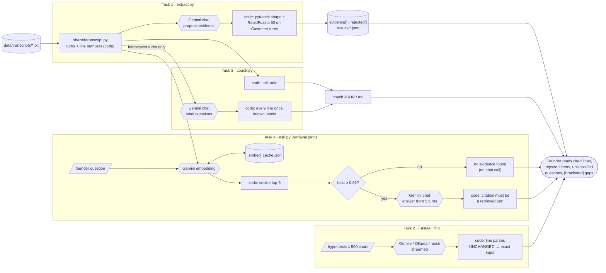

# Design Review · Groundwork · AIPSD-project team

Members: Otar Khunashvili · Ghmertoto · spec keeper · Goga Jintcharadze · Goga-ml · repo keeper · Dachi Khelashvili · heinrichcorneliusagrippa · eval keeper · Petre Kharazashvili · petre-kharazashvili · ops keeper (providers, cost, latency)
Repo: https://github.com/Goga-ml/AIPSD-project · Graded commit: tag `design-review`

## 1 · Problem, users, success criteria

**Problem.** Founders validate ideas by interviewing potential customers, then decide from memory and notes, and memory keeps the flattering parts. Three things go wrong. Hypotheses like "farmers want better tools" can never be proved wrong, so every interview seems to confirm them. Interview questions lead the customer ("Wouldn't an app that predicts stock be great?"), so a polite "sure" is recorded as validation. And after ten interviews nobody can say who actually said what, so a hypothetical "would pay maybe 20 GEL" gets remembered as real spending. Today founders reread transcripts by hand or trust their notes; neither separates evidence from compliments, and neither can be checked by someone else.

**Groundwork** is an open-source, privacy-first customer-discovery tool. It separates real evidence (pains, workarounds, current spending, commitments) from polite answers and assumptions, and ties every claim to a line in a transcript, in the form `[interview_01:L11]`. Its rule is that the model proposes and the code decides: counting, quote matching, line numbers and validation are done in code, and the model is only used for judgment.

**Users.** Early-stage founders and student teams running customer-discovery interviews. They have their interviews as text transcripts, usually 3 to 10 per segment, and need to decide what to build next. Some self-host and run a slow local model, so they need fast first feedback.

Specs: shared contract `docs/INTERFACES.md` v1 (transcript format, parser, JSON shapes); one spec per feature in `hw1/heinrichcorneliusagrippa/spec.md`, `hw1/petre-kharazashvili/spec.md`, `hw1/Ghmertoto/spec.md`, `hw1/Goga-ml/spec.md`. Shared test data with planted facts: `data/transcripts/` and `answer_key.json`.

| # | Success criterion | Measured by | Today |
|---|---|---|---|
| S1 | **No invented evidence.** Every accepted quote matches a Customer line in code (RapidFuzz ≥ 90), and at least 13 of the 14 planted facts are recovered with the right type and line | `hw1/heinrichcorneliusagrippa/src/check_planted.py` over the committed `results/*.json` | 12/14 recovered, 0 invented quotes accepted; the "would pay maybe 20 GEL" trap was not counted as spending ([golden](../hw1/heinrichcorneliusagrippa/golden.md)) |
| S2 | **Every answer is cited or refused.** Questions answered in the transcripts cite the right `interview:line`; unrelated questions return exactly `no evidence found` with zero chat-model calls | `hw1/Goga-ml/golden.md` (3 golden questions) and `pytest hw1/Goga-ml` | 3/3 live pass; abstained with 0 chat calls at `min_score` 0.65 ([golden](../hw1/Goga-ml/golden.md)) |
| S3 | **Hypotheses are judged before interviews.** The linter gives the expected `falsifiable`/`vague` verdict on all golden hypotheses, and a falsifiable one is returned byte-identical | `hw1/petre-kharazashvili/golden.md` (3 hypotheses through `POST /lint`) | 3/3 verdicts correct; rewrite byte-identical (176/176 bytes). Run on `gemini-3.6-flash` because the 3.8 free quota was used up ([golden](../hw1/petre-kharazashvili/golden.md)) |
| S4 | **Biased interview questions are caught.** The talk ratio equals an independent word count, and every planted leading question gets the `leading` label with a rewrite | `pytest hw1/Ghmertoto` (28 tests) and `hw1/Ghmertoto/src/golden.py` against its answer key | Ratio exact on all 5 transcripts; planted leading questions flagged in every run the model answered (3/3 on interview_01, 1/1 on interview_02); the other runs failed on 503 or quota, reported as unclassified ([golden](../hw1/Ghmertoto/golden.md)) |

## 2 · Architecture and data flow

Four tools share one parser and one contract (`docs/INTERFACES.md`); they are not one service yet. Every model call goes through the feature's `llm.py`, which logs tokens, cost and latency.

| Model call | Model id | Input | Output | Validated by |
|---|---|---|---|---|
| Extract evidence | `gemini-3.8-flash` (live: `3.5-flash-lite`) | one transcript, no line numbers | JSON items, exact quotes | shape, quote match ≥ 90, 3 attempts |
| Label questions | `gemini-3.8-flash` | Interviewer turns `L<n>: text` | label per line | each line once, known labels, 3 attempts, else `unclassified` |
| Embed | `gemini-embedding-001` | `"Speaker: text"` per turn, question | vectors | cosine vs `min_score` 0.65 |
| Answer | `gemini-3.8-flash` | top-5 tagged turns | cited answer | invented tags stripped; none valid → abstain |
| Lint | `gemini-3.8-flash` (live: `3.6-flash`) | rubric, 2 few-shots, hypothesis | 3 streamed lines | parser; bad format → readable error |

**Line numbers never come from a model:** the parser numbers turns, extract matches quotes back to a turn, ask checks citations against the retrieved set. **Coach never sends customer text**, and its talk ratio is pure code. **The embedding cache** means a new question costs one embedding call. **The human is the founder:** nothing is decided automatically, and rejected, abstained and unclassified items are shown beside accepted ones. With no image or audio input yet, our Week 3 low-confidence routes are in [`docs/confidence-policy.md`](confidence-policy.md). Stores: transcripts (read-only), the git-ignored cache, extract results, [`logs/usage.jsonl`](../logs/usage.jsonl).

## 3 · Risks and safety threats

| Risk | What a user would see | Mitigation (link, or plan and week) | Owner |
|---|---|---|---|
| **Invented evidence** | a quote the customer never said | exists: quote matched in code, failures in `rejected[]` ([`extract.py`](../hw1/heinrichcorneliusagrippa/src/extract.py)); 0 invented quotes accepted live | Dachi |
| **Ungrounded answer** | an answer to an off-topic question | exists: abstain below 0.65 with no chat call, invented citations stripped ([0002](decisions/0002-ask-min-score-0-65.md)). Margin is thin (0.704 vs 0.634): re-tune on 10 questions by Week 11 | Goga |
| **Missed evidence** | a pain silently absent | partly: no code check catches omissions (12/14). Week 6: re-run on `3.8-flash`, test a prompt rule on a 4th transcript | Dachi |
| **Wrong question labels** | a leading question missed | exists: rubric, validation, `unclassified` on failure, labels shown as model judgments ([`classifier.py`](../hw1/Ghmertoto/src/classifier.py)) | Otar |
| **Interviewee privacy** | customer words sent to a third party | partly: coach sends no customer turns; keys from env only; no transcript text in logs. Extract and ask send customer turns to Gemini, whose free tier may use content to improve Google's products. From now: no real transcripts on free-tier keys; Week 13: Ollama for every feature | Petre |
| **Vendor failure** | 503, 429 daily quota, retired model (404) | exists: model by env var ([0003](decisions/0003-default-model-gemini-3-8-flash.md)), no retry on 429, 30 s timeout, clean exit 1. Week 10: paid key + fallback model | Petre |
| **Cost and latency** | 25 s before the first verdict; output up to 5× estimates | exists: cost logged per call. Week 6: lower the thinking level | Goga |
| **Prompt injection** | a manipulated label or verdict | exists: the model only proposes and code checks every line, quote and citation, so the worst case is a wrong judgment, never an action | Otar |

## 4 · Evaluation plan

- Golden set: [`evals/golden.yaml`](../evals/golden.yaml), 5 retrieval questions (2 factual, 1 reasoning, 1 edge, 1 refusal), threshold 0.70.
- Last live run: [`evals/results/2026-10-15-live-ask.json`](../evals/results/2026-10-15-live-ask.json), `min_score` 0.65. **2 of the 3 items run pass; g3 and g4 not yet run (free-tier quota). 2/5 overall, below 0.70.**
- What failed and why: g1 cited 45 GEL and 200 GEL and skipped the "maybe 20 GEL" trap, but left out interview_03's "pays nothing" (L11). We have not yet checked whether retrieval or the model dropped it; the run did not record `retrieved`.
- Other features' committed checks: extract 12/14 planted facts ([golden](../hw1/heinrichcorneliusagrippa/golden.md)), coach 100% of planted leading questions in every classified run ([golden](../hw1/Ghmertoto/golden.md)), linter 3/3 verdicts, 0/3 on latency ([golden](../hw1/petre-kharazashvili/golden.md)).
- By Week 11: 10 questions (3 factual, 2 reasoning, 2 edge, 2 refusal, 1 format), linter hypotheses that are not its few-shots, `evals/run_golden.py` writing the result file (today it is compiled by hand from logged runs), and the run in CI. The 0.70 gate blocks merging any prompt, model, `min_score` or chunking change that drops the pass rate below 0.70.

## 5 · Token budget

Medians from the 13 real calls in [`logs/usage.jsonl`](../logs/usage.jsonl), copied with their sources from the 15 October runs (2 to 4 calls per feature):

| Feature | Model | Tokens in / out | Cost per request | Latency | Source |
|---|---|---|---|---|---|
| Ask, answered | `3.8-flash` + embedding | ~300 / 484 | $0.0020 | not logged | 2 calls |
| Ask, abstained | embedding only | ~20 / 0 | ~$0.000003 | not logged | golden Q2; spec price |
| Coach, per interview | `3.8-flash` | 438 / 2,531 | $0.0099 | not logged | 4 calls |
| Extract, per interview | `3.5-flash-lite` | 564 / 249 | $0.0008 | not logged | 3 calls |
| Lint | `3.6-flash` | 576 / 220 | $0.0013 | 26.6 s (TTFB 25.1 s) | 3 calls |

Only the linter kept latency; by 27 October every `llm.py` appends to `logs/usage.jsonl` instead of only stderr.

**Monthly at 20 founders**, each with 10 interviews (extract + coach), 50 questions and 20 lints: 10 × $0.004 (extract on `3.8-flash`, spec estimate) + 10 × $0.0099 + 50 × $0.0020 + 20 × $0.0013 ≈ $0.26 per founder, **≈ $5.30 a month**, ≈ $10.60 after prices double on 1 January 2027. Thinking tokens dominate: coach writes ~2,500 output tokens for ~6 labels.

**RAG or long context.** Three transcripts are ~2,000 tokens: sending them all adds ~$0.0014 per question, less than the thinking output. At 30 interviews (~20,000 tokens) it is ~$0.015 against ~$0.0002 for five turns, 75× the input. Beyond cost, one turn per chunk gives every citation a line that code can check, and an off-topic question is refused for $0. Extract and coach read one whole interview (~900 tokens) on purpose: recall needs all of it.

## 6 · Team, roles and decisions

- Team contract: [`TEAM-CONTRACT.md`](../TEAM-CONTRACT.md) · roles: [`docs/TEAM-REPO.md`](TEAM-REPO.md) section 1
- Decisions: [0001 shared interface contract](decisions/0001-shared-interface-contract.md) · [0002 `min_score` 0.65](decisions/0002-ask-min-score-0-65.md) (the setting we tuned) · [0003 default model](decisions/0003-default-model-gemini-3-8-flash.md)
- AI drafting of sections 2 to 6 is logged in [`docs/delegation-log.md`](delegation-log.md).
- Next: Week 5 puts the four tools behind one entry point as validated tool calls (Goga drives). Dachi grows the golden set to 10, Petre adds the fallback model and the persistent usage log, Otar keeps `INTERFACES.md` and this review true.
